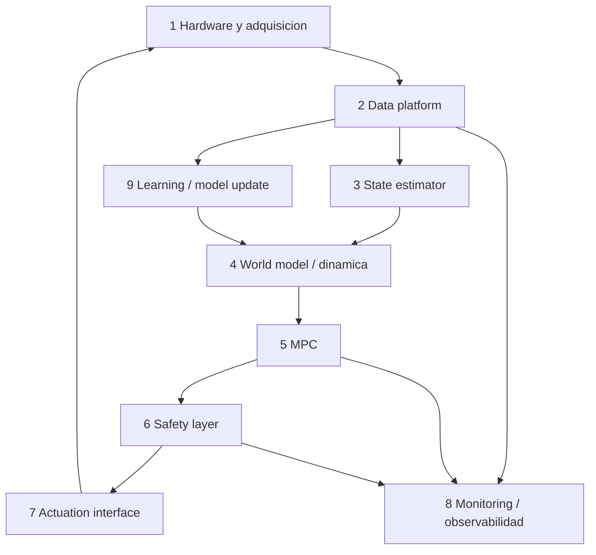

# Documentación de arquitectura — Sistema de cultivo automatizado

Esta carpeta describe **la arquitectura a la que queremos llegar**: un lazo cerrado
de control (MPC/RL) sobre el hardware que ya existe (ESP32 + sensores + relés),
apoyándose en la plataforma de predicción **Astaroth** para el *world model*.

> **Estado de este documento.** Describe el **objetivo** y marca explícitamente
> qué ya existe (`✅`), qué está a medias (`🟡`) y qué falta (`❌`). El "estado
> actual" refleja el código del repositorio en el momento de escribirlo.

## Cómo leer esta documentación

| Documento | Contenido |
|---|---|
| [`arquitectura.md`](./arquitectura.md) | Visión general: las 9 capas, componentes, flujos y mapa de despliegue. **Empezar aquí.** |
| [`datos.md`](./datos.md) | Modelo de datos: estado `x_t`, acciones `u_t`, setpoints y dataset de entrenamiento. |
| [`control.md`](./control.md) | Capas 4–7: world model (Astaroth), MPC, safety y actuación. |
| [`observabilidad-aprendizaje.md`](./observabilidad-aprendizaje.md) | Capas 8–9: métricas, trazas de decisión y reentrenamiento. |
| [`roadmap.md`](./roadmap.md) | Fases de implementación con entregables y criterios de aceptación. |

## Resumen ejecutivo

El proyecto ya tiene **hardware funcional** (4 sensores + 4 relés), **telemetría en
TimescaleDB** y **entrega de configuración** por fases (plant-service). Lo que falta
es el **cerebro**: estimar el estado del cultivo, predecir su evolución y decidir
acciones de forma óptima y segura.

## Las 9 capas y su estado

| # | Capa | Estado | Resumen |
|---|---|---|---|
| 1 | Hardware / adquisición | ✅ | ESP32: BME680, AS7341, MH-Z19B, Soil EC + relé de 4 canales |
| 2 | Data platform | 🟡 | Telemetría en TimescaleDB vía MQTT; acciones no son serie temporal unificada |
| 3 | State estimator | 🟡 | Métricas derivadas deterministas; falta el vector `x_t` |
| 4 | World / dynamics model | ❌ | No existe. Candidatos en Astaroth (`transformerApi`, `causalTransformer-api`) |
| 5 | MPC | ❌ | No existe |
| 6 | Safety layer | 🟡 | Validación básica de comandos; sin límites ni interlocks |
| 7 | Actuation / control interface | 🟡 | El camino backend→MQTT→ESP existe; ningún controlador lo usa todavía |
| 8 | Monitoring / observability | 🟡 | `logs/`, healthchecks, `actuator_events`; falta trazas de modelo y alarmas |
| 9 | Learning / model update | ❌ | No existe |

## Principio rector

> **Cerrar el lazo con un baseline barato antes de invertir en modelos neuronales.**

Un modelo sencillo (XGBoost o lineal de espacio de estados) permite tener el lazo
completo funcionando en **shadow mode** en poco tiempo y genera los datos y la
infraestructura (contratos, métricas, trazas) que el transformer necesita después.
Empezar por el `causalTransformer` implica primero reparar piezas ausentes
(`src/models/`, config) y montar Celery/Hydra/MLflow, sin datos reales todavía.

## Convenciones usadas en estos documentos

- **Rutas** son relativas a la raíz del proyecto `tesis/`.
- **Topics MQTT** se citan tal cual (`growbox/<alias>/data`).
- Los bloques marcados como *propuesto* **no existen aún** en el código.
