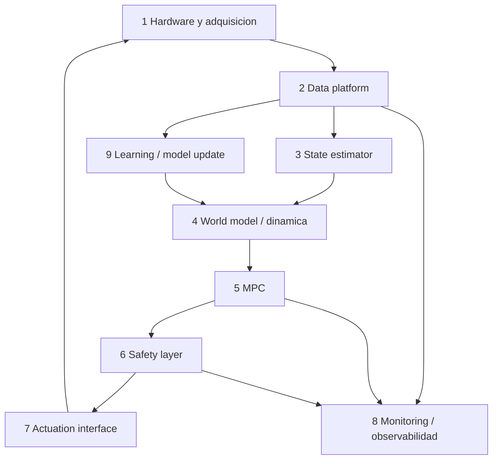

# Documentación de arquitectura — Sistema de cultivo automatizado

Esta carpeta describe **la arquitectura a la que queremos llegar**: un lazo cerrado
de control (MPC/RL) sobre el hardware que ya existe (ESP32 + sensores + relés),
apoyándose en la plataforma de predicción **Astaroth** para el *world model*.

> **Estado de este documento.** Describe el **objetivo** y marca explícitamente
> qué ya existe (`✅`), qué está a medias (`🟡`) y qué falta (`❌`). El "estado
> actual" refleja el código del repositorio en el momento de escribirlo.

## Cómo leer esta documentación

| Documento | Contenido |
|---|---|
| [`arquitectura.md`](./arquitectura.md) | Visión general: las 9 capas, componentes, flujos y mapa de despliegue. **Empezar aquí.** |
| [`datos.md`](./datos.md) | Modelo de datos: estado `x_t`, acciones `u_t`, setpoints y dataset de entrenamiento. |
| [`control.md`](./control.md) | Capas 4–7: world model (Astaroth), MPC, safety y actuación. |
| [`observabilidad-aprendizaje.md`](./observabilidad-aprendizaje.md) | Capas 8–9: métricas, trazas de decisión y reentrenamiento. |
| [`roadmap.md`](./roadmap.md) | Fases de implementación con entregables y criterios de aceptación. |
| [`especificacion.md`](./especificacion.md) | **Especificación de implementación MPC/RL**: rol de cada modelo de Astaroth, contratos, especificación por capa, fases revisadas y mapa de pendientes. |
| [`migracion.md`](./migracion.md) | Plan de transición: arquitectura **actual vs objetivo**, brecha por capa y fases. |

## Resumen ejecutivo

El proyecto ya tiene **hardware funcional** (4 sensores + 4 relés), **telemetría en
TimescaleDB** y **entrega de configuración** por fases (plant-service). Lo que falta
es el **cerebro**: estimar el estado del cultivo, predecir su evolución y decidir
acciones de forma óptima y segura.



## Las 9 capas y su estado

| # | Capa | Estado | Resumen |
|---|---|---|---|
| 1 | Hardware / adquisición | ✅ | ESP32: BME680, AS7341, MH-Z19B, Soil EC + relé de 4 canales |
| 2 | Data platform | ✅ | Telemetría en TimescaleDB vía MQTT; `control_actions` y `plant_service.setpoint_snapshots` |
| 3 | State estimator | ✅ | `state.py`: ventana `x_t`, máscaras, outliers por cota, scaler z-score versionado, `x*` |
| 4 | World / dynamics model | 🟡 | CausalFormer integrado (rollout con `u`); skill sobre persistencia en 9/10 métricas, `par` pendiente |
| 5 | MPC | ❌ | No existe |
| 6 | Safety layer | 🟡 | Validación básica de comandos; sin límites ni interlocks |
| 7 | Actuation / control interface | 🟡 | El camino backend→MQTT→ESP existe; ningún controlador lo usa todavía |
| 8 | Monitoring / observability | 🟡 | `logs/`, healthchecks, `actuator_events`; falta trazas de modelo y alarmas |
| 9 | Learning / model update | ❌ | No existe |

## Principio rector

> **Cerrar el lazo con un baseline barato antes de invertir en modelos neuronales.**

Un modelo sencillo (XGBoost o lineal de espacio de estados) permite tener el lazo
completo funcionando en **shadow mode** en poco tiempo y genera los datos y la
infraestructura (contratos, métricas, trazas) que el transformer necesita después.
Empezar por el `causalTransformer` implica primero reparar piezas ausentes
(`src/models/`, config) y montar Celery/Hydra/MLflow, sin datos reales todavía.

## Convenciones usadas en estos documentos

- **Rutas** son relativas a la raíz del proyecto `tesis/`.
- **Topics MQTT** se citan tal cual (`growbox/<alias>/data`).
- Los bloques marcados como *propuesto* **no existen aún** en el código.

## Puesta en marcha

```bash
# 1) Modelos de Astaroth (solo los que usa la tesis)
cd Astaroth && node dev.js --tesis        # xgboost :8011, transformer :8013, causal :8014

# 2) Resto del entorno (DB/MQTT docker + backend + web + servicios + ESP simulado)
cd tesis && node dev.js --esp-simulation  # :3010, :5173, :8000, :8100

# parar
cd tesis && node dev.js --stop
cd Astaroth && node dev.js --stop
```

Si el proceso se lanza desde un shell efímero (CI, agente), `dev.js` daemoniza los
servicios pero el shell puede matar el grupo. Para un entorno persistente:

```bash
systemd-run --user --unit=tesis-dev \
  --setenv=PATH=$HOME/.config/nvm/versions/node/v26.8.1/bin:/usr/local/bin:/usr/bin:/bin \
  --working-directory=$HOME/Proyectos/seeds/tesis \
  /bin/sh -c 'node dev.js --esp-simulation; exec sleep infinity'
systemctl --user status tesis-dev   # o: journalctl --user -u tesis-dev -f
```

El `sleep infinity` mantiene vivo el cgroup: `dev.js` termina tras daemonizar y, si
no, systemd mata a los hijos al cerrar la unidad.

### Comprobación rápida del lazo

```bash
curl -s localhost:3010/health          # database + mqtt
curl -s localhost:8100/health          # DB + Astaroth (xgb/transformer/causal)
curl -s localhost:8100/state           # ventana x_t
curl -s -X POST localhost:8100/predict -H 'content-type: application/json' \
  -d '{"model":"causal","run_id":"tesis-ct-004","h":2}'
# relé: API → MQTT → ESP (el payload va anidado)
curl -s -X POST localhost:3010/actuators/canal_1/command \
  -H 'content-type: application/json' -d '{"command":"set","payload":{"state":"ON","channel":1}}'
```
