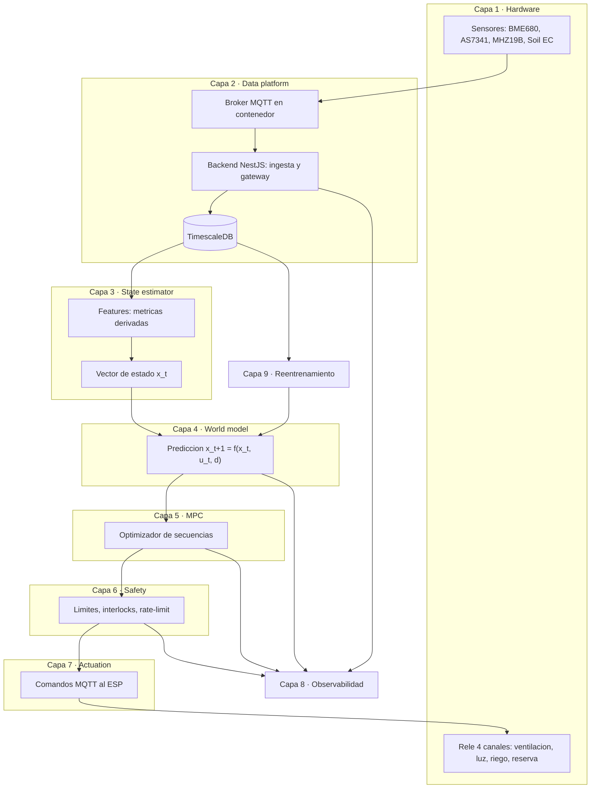
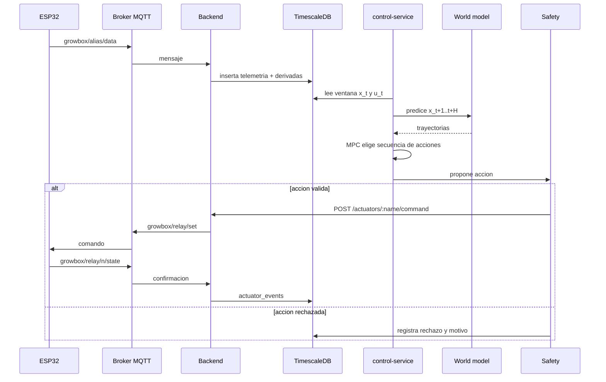

# Arquitectura objetivo

Sistema de cultivo automatizado con **lazo cerrado de control**: los sensores
miden el entorno, un modelo estima y predice el estado del cultivo, un MPC decide
acciones y una capa de seguridad las valida antes de llegar a los relés del ESP32.

## 1. Vista de capas

## 2. Componentes por capa

### Capa 1 — Hardware / adquisición ✅

| Elemento | Detalle | Ruta |
|---|---|---|
| Firmware ESP32 | Arduino + PlatformIO, WiFi + MQTT + OTA | `esp32/src/main.cpp`, `esp32/platformio.ini` |
| Sensores | BME680 (I²C), AS7341 (I²C), MH-Z19B (UART), Soil EC (RS485) | `esp32/src/sensors/*` |
| Actuador | Relé 4 canales | `esp32/src/actuators/relay/*` |
| Config del dispositivo | WiFi, broker, OTA, `device_id` | `esp32/include/app_config.h`, `esp32/src/mqtt/device_config.cpp` |

Mapeo de canales del relé (ver `readme.md` §10):

| Canal | Nombre | Uso |
|---|---|---|
| 1 | `canal_1` | Ventilación principal |
| 2 | `canal_2` | Iluminación principal |
| 3 | `canal_3` | Riego principal |
| 4 | `canal_4` | Libre / reserva |

> ⚠️ Hoy los sensores corren en **modo simulación** (no se detectan por I²C/UART).
> Ver `datos.md` §7.

#### Modo simulación del ESP (sin hardware)

Si no hay placa conectada (o falta PlatformIO), `dev.js` levanta un **ESP simulado**
(`tools/esp-sim.js`) que habla MQTT igual que el firmware: publica telemetría de los
4 sensores y responde a los comandos (`read`, `config`, `relay/set`). Así el resto del
stack (backend, DB, plant-service) funciona sin hardware.

| Forma | Comando |
|---|---|
| Automática | `node dev.js` — si no detecta ningún puerto serie, cae a simulación |
| Forzada | `node dev.js --esp-simulation` (o `npm run dev:sim`) |
| Solo el simulador | `npm run esp32:sim` |

Variables opcionales del simulador: `MQTT_BROKER_URL`, `SIM_CLIENT_ID`,
`DEVICE_ID` y `SIM_INTERVAL_*_MS` (ver cabecera de `tools/esp-sim.js`).

### Capa 2 — Data platform 🟡

| Elemento | Detalle | Ruta |
|---|---|---|
| Broker MQTT | Mosquitto en contenedor, puertos 1883 / 9001 (WS) | `db/docker-compose.yml`, `db/mosquitto/mosquitto.conf` |
| Ingesta MQTT | Suscripciones y ruteo de mensajes | `backend/src/mqtt/mqtt.service.ts` |
| Persistencia | Hypertable `telemetry` + `actuator_events`, `device_boots`, `sensor_configs`, `actuator_configs` | `db/init.sql` |
| API de consulta | `/telemetry/:alias/readings`, `/Derivates/:alias/:metricName` | `backend/src/telemetry`, `backend/src/derivates` |
| Config de cultivos | Fases y objetivos (plant-service, esquema `plant_service`) | `plant-service/app/**` |

**Topics MQTT en uso**

| Topic | Dirección | Payload |
|---|---|---|
| `growbox/<alias>/data` | ESP → backend | métricas del sensor (`{device_id, timestamp, metrics}`) |
| `growbox/<alias>/read` | backend → ESP | `{}` (forzar lectura) |
| `growbox/<alias>/config` | ↔ | configuración del sensor |
| `growbox/<alias>/read_config` | backend → ESP | pedir config actual |
| `growbox/relay/<n>/state` | ESP → backend | `{channel, state}` |
| `growbox/relay/set` | backend → ESP | `{channel, state}` |
| `growbox/relay/read` / `config` | ↔ | estado / config del relé |
| `growbox/status` | ESP → backend | `boot`/`online`/LWT `offline` |

**Brechas de esta capa**
- Las **acciones** (`u_t`) no están en la serie temporal: hoy viven en
  `actuator_events` (`old_state`, `new_state`, `reason`, `created_at`).
- Existe **doble almacén de telemetría**: el backend (`telemetry`) y
  plant-service (`plant_service`); hay que consolidar.
- No se registran todavía **setpoints/fases** como serie temporal.

### Capa 3 — State estimator 🟡

Hoy hay **ingeniería de features determinista**, no un estimador aprendido.

| Elemento | Detalle | Ruta |
|---|---|---|
| Servicio de derivadas | Calcula métricas derivadas al ingerir | `backend/src/derivates/derivates.service.ts` |
| Fórmulas | `bme680` (vpd, dew_point, altitude), `as7341` (ndvi, par, chlorophyll_index, red_edge_ratio, nir_reflectance, lux_estimado), `soil_ec` (ec_compensated, salinity, tds), `mhz19b` (co2_change_rate) | `backend/src/derivates/formulas/*.ts` |

**Objetivo:** definir el vector de estado `x_t` (ver `datos.md`) e incorporar
ventanas temporales, normalización, imputación y filtrado de outliers.

### Capa 4 — World / dynamics model ❌

No existe en la tesis. Se apoyará en **Astaroth** (proyecto hermano).
Detalle completo en [`control.md`](./control.md).

### Capa 5 — MPC ❌

No existe. Empezará con horizontes cortos y acciones discretas. Ver `control.md`.

### Capa 6 — Safety layer 🟡

| Ya existe | Ruta |
|---|---|
| Validación de canal (1–4) y estado (`ON`/`OFF`) en comandos de relé | `backend/src/actuators/actuators.controller.ts` |
| Validación de config en firmware | `esp32/src/actuators/relay/command_handler.cpp` |

**Falta:** límites físicos, interlocks, `rate limit`, `min_interval` de riego
(declarado en `plant-service` pero no aplicado), kill-switch y registro de
rechazos. Ver `control.md` §4.

### Capa 7 — Actuation / control interface 🟡

| Ya existe | Ruta |
|---|---|
| `POST /actuators/:name/command` publica `growbox/relay/set` | `backend/src/actuators/actuators.controller.ts` |
| Ruteo en el ESP | `esp32/src/mqtt/router.cpp` |
| Gateway a plant-service | `backend/src/plant-proxy.ts` |

**Falta:** que el actor sea el MPC, confirmaciones/acks, idempotencia y modo shadow.
El ESP **no consume** todavía `/api/v1/device/config` de plant-service (el firmware
no tiene cliente HTTP; solo MQTT).

### Capa 8 — Monitoring / observability 🟡

Hay `logs/*`, healthchecks de Docker, `/health`, `/health/mqtt`,
`/health/telemetry-count` y el histórico `actuator_events`. Falta lo específico
de control: métricas de predicción, **trazas de decisión** y alarmas.
Ver [`observabilidad-aprendizaje.md`](./observabilidad-aprendizaje.md).

### Capa 9 — Learning / model update ❌

No existe pipeline de reentrenamiento ni versionado de modelos en la tesis.
Astaroth aporta scripts de entrenamiento reutilizables. Ver
[`observabilidad-aprendizaje.md`](./observabilidad-aprendizaje.md).

## 3. Flujo de control (objetivo)

## 4. Mapa de despliegue

| Servicio | Puerto | Cómo se levanta |
|---|---|---|
| TimescaleDB | 5438 | `db/docker-compose.yml` (contenedor `cea-timescaledb`) |
| Broker MQTT | 1883 / 9001 | `db/docker-compose.yml` (contenedor `cea-mqtt`) |
| Backend NestJS | 3000 | `backend/` (`npm run start:dev`) |
| Interfaz web (Vite) | 5173 | `interfaz web/` |
| plant-service (FastAPI) | 8000 | `plant-service/` (uvicorn) |
| Firmware ESP32 | `/dev/ttyUSB0` | `esp32/` (PlatformIO) |
| ESP simulado *(sin hardware)* | — (MQTT 1883) | `tools/esp-sim.js` vía `dev.js --esp-simulation` |
| **control-service** *(propuesto)* | 8100 | nuevo, integrado en `dev.js` |

Todo se orquesta con `node dev.js` (ver `dev.js`), que además valida las
interconexiones (broker, dependencias del backend, gateway backend→plant).

## 5. Decisiones de arquitectura

| # | Decisión | Razón |
|---|---|---|
| A1 | **Baseline antes de neuronal** | Cierra el lazo y genera datos/infra sin depender de modelos pesados |
| A2 | **El control vive fuera del ESP** | El ESP mide y obedece; el cálculo pesado está en servicios |
| A3 | **Un solo almacén de telemetría** | Evitar divergencia backend vs plant-service |
| A4 | **Toda acción se registra** (incluidas manuales y rechazadas) | Sin `u_t` no hay world model ni auditoría |
| A5 | **Shadow mode primero** | Valida predicciones/decisiones sin riesgo físico |
| A6 | **Reutilizar la arquitectura de Astaroth**, no su pipeline | Astaroth está acoplado al ecommerce (`core/adt.py`, RFM, Celery/MLflow) |

## 6. Riesgos

| Riesgo | Impacto | Mitigación |
|---|---|---|
| Sensores en simulación | Datos no representativos | Conectar/cablear sensores o marcar `simulated` en los datos |
| Reconexiones MQTT del ESP | Huecos en la serie | Corregir keepalive en firmware |
| Cadencia 15–25 s vs. modelos horarios | Desajuste con Astaroth | Re-muestreo/agregación y `seq_len` adaptado |
| Doble telemetría | Inconsistencia | Consolidar en `telemetry` |
| Falta de datos históricos de acciones | Imposible entrenar dinámica | Fase 0 (registrar `u_t`) |
