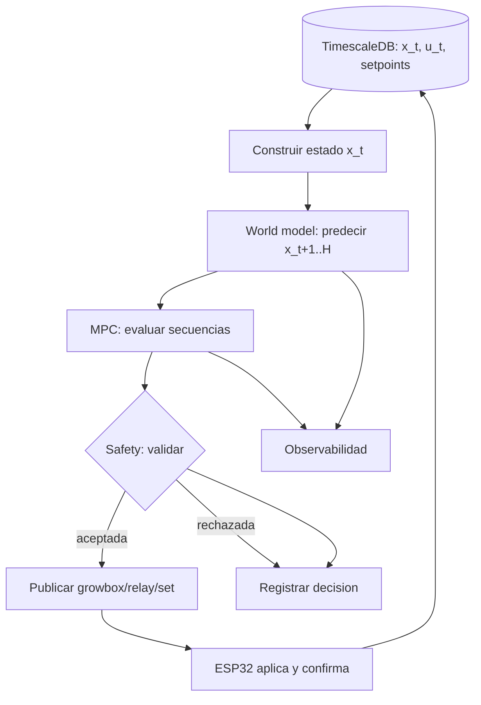

# Control: world model, MPC, safety y actuación (capas 4–7)

Este documento cubre el "cerebro" del sistema: cómo se predice la evolución del
cultivo, cómo se decide qué hacer, cómo se valida y cómo se ejecuta.

## 1. Capa 4 — World / dynamics model ❌

**Formulación:** un modelo que aproxima la dinámica

```
x_{t+1} = f(x_t, u_t, d_t) + ruido
```

donde `x_t` es el estado (ver `datos.md` §1), `u_t` las acciones del relé
(`datos.md` §2) y `d_t` perturbaciones/contexto (hora, fase, exterior).

### 1.1 Opciones de modelo (de barata a cara)

| Opción | Cuándo | Notas |
|---|---|---|
| **Lineal de espacio de estados** | Primer baseline | Interpretable, mínimos datos, rápido |
| **XGBoost por variable** | Baseline sólido | Reusa `Astaroth/XGBoost-api`; `u_t` como columnas |
| **iTransformer** | Serie multivariante | Reusa `Astaroth/transformerApi`; acciones como variates |
| **Causal Transformer** | Dinámica con acciones | Reusa `Astaroth/causalTransformer-api`; es el marco más alineado |

### 1.2 Reutilización de Astaroth

`Astaroth` es una plataforma de APIs ML (FastAPI) para el ecommerce. Componentes
relevantes para predicción:

| Servicio | Puerto | Aporte | Estado / lo que falta |
|---|---|---|---|
| `causalTransformer-api` | 8014 | Modela `x_{t+1}` = f(historia, tratamientos `u_t`, estáticas) — **es un dynamics model** | Falta `src/models/` (no vendorizado); usa Celery + Hydra + MLflow + Ray; ejemplos médicos |
| `transformerApi` (iTransformer) | 8013 | Forecast seq→seq multivariante | Falta el objeto `config`; imports rotos (`api.main` vs `apis.main`) |
| `XGBoost-api` | 8011 | Regresión con lags; baseline | Ligero y listo; no es state-space real |
| `clustering-api` | 8010 | — | No modela dinámica; solo útil para discretizar regímenes |
| `core/` | — | Ingesta/limpieza legacy (`.ADT`, RFM) | Acoplado al ecommerce |

**Recomendación:** adoptar la **arquitectura** del `causalTransformer`
(`prev_outputs`, `prev_treatments`, `current_treatments`, `static_features`,
`active_entries`) como contrato conceptual, e implementarla primero con un
baseline propio en `tesis/control-service`. El modelo neuronal se integra después.

Contrato de datos de `causalTransformer-api` (a replicar):

```
prev_treatments     # u_{t-k..t-1}
current_treatments  # u_t
static_features     # contexto fijo (fase, especie)
prev_outputs        # x_{t-k..t}
active_entries      # máscara de validez
```

### 1.3 Métricas y artefactos

- Error por variable y por horizonte: **MAE / RMSE** (`x_t+1`, `x_t+3`, `x_t+H`).
- Comparación contra un *persistence baseline* (`x_{t+1} = x_t`).
- Artefacto versionado (pesos + scaler + metadatos + `dataset_hash`).

## 2. Capa 5 — MPC ❌

**Objetivo:** elegir la secuencia de acciones que minimiza un coste a lo largo de
un horizonte, respetando restricciones.

```
min_{u_t..u_{t+H-1}}  Σ_τ [ w_x · ‖x_τ − x*_τ‖²  +  w_u · ‖u_τ‖  +  w_Δu · ‖u_τ − u_{τ-1}‖ ]
sujeto a:  x_τ+1 = f(x_τ, u_τ, d_τ)          (world model)
           u_τ ∈ {0,1}^4                       (relés)
           restricciones de safety (capa 6)
```

- `x*_τ` = **setpoint** de la fase activa (`plant-service`, ver `datos.md` §3).
- Espacio de acciones **discreto**: 4 canales binarios.

| Parámetro | Valor inicial propuesto |
|---|---|
| Horizonte `H` | 3–6 pasos |
| Frecuencia de decisión | 1–5 min |
| Método | **enumeración exacta** para `H` corto (2⁴ᴴ) → luego MPPI/CEM |
| Coste de cambios | penalizar conmutaciones rápidas (`w_Δu`) |

> A horizonte corto y acciones binarias, la enumeración es viable y da un MPC
> exacto. Solo cuando `H` crezca (o las acciones se vuelvan continuas) se justifica
> un optimizador muestral (MPPI/CEM) o RL.

## 3. Capa 6 — Safety layer 🟡

Toda acción propuesta por el MPC pasa por aquí **antes** del hardware. Debe poder
**validar, limitar o rechazar**, y **registrar** el motivo.

### 3.1 Reglas concretas

| Regla | Descripción |
|---|---|
| Límites físicos | No accionar canales no existentes; respetar rangos de sensores |
| `min_interval` de riego | Ya declarado en `plant-service` (`irrigation.min_interval_hours`); **aplicarlo aquí** |
| Interlocks | p. ej. no activar riego sin condición mínima; no ventilación y humidificación simultáneas si aplica |
| Rate limit | Máximo de conmutaciones por canal por unidad de tiempo (protege el relé) |
| Duración máxima | Corte automático de un canal tras `duration_seconds` |
| Watchdog | Si el control-service cae, dejar los actuadores en estado seguro |
| Kill-switch | Comando manual que deshabilita el MPC |

### 3.2 Contrato de decisión

```
{ time, channel, proposed_state, decision: accepted|clamped|rejected,
  applied_state, rule, reason }
```

Todo rechazo/clamp se persiste (capa 8) para auditoría.

### 3.3 Lo que ya existe

- Validación de canal (1–4) y estado (`ON`/`OFF`) en
  `backend/src/actuators/actuators.controller.ts`.
- Validación de configuración en firmware
  (`esp32/src/actuators/relay/command_handler.cpp`).

## 4. Capa 7 — Actuation / control interface 🟡

El camino de ejecución **ya existe**: el backend publica comandos y el ESP los
ejecuta y confirma.

| Paso | Artefacto |
|---|---|
| Emitir comando | `POST /actuators/:name/command` (`backend/src/actuators/actuators.controller.ts`) |
| Publicar | `mqtt.service.ts` → `growbox/relay/set` |
| Ejecutar | `esp32/src/mqtt/router.cpp` → `relay::handle_set_command` |
| Confirmar | ESP publica `growbox/relay/<n>/state` → `actuator_events` |

**Falta:**
- Que el actor sea el **MPC** (hoy es manual / API).
- **Acks** y **idempotencia** (evitar aplicar dos veces el mismo comando).
- **Shadow mode:** el MPC decide pero **no** publica; solo se registra la decisión
  para compararla con el control vigente.

### 4.1 Servicio propuesto `control-service`

```
tesis/control-service/   (propuesto, FastAPI, puerto 8100)
├── state.py        # construye x_t desde TimescaleDB
├── world_model.py  # carga modelo versionado y predice
├── mpc.py          # optimizador de horizonte corto
├── safety.py       # reglas de la capa 6
├── actuation.py    # publica comandos (o shadow)
└── api/            # /health, /decide, /predict, /dataset
```

Se integra en `dev.js` como un componente más (como plant-service).

## 5. Flujo completo (objetivo)


