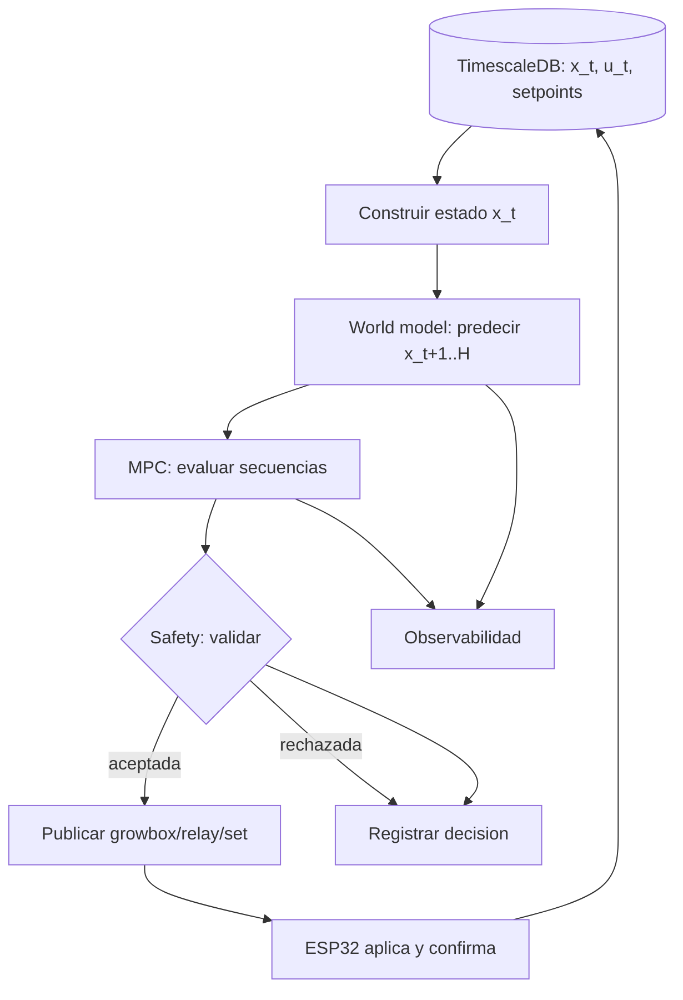

# Control: world model, MPC, safety y actuación (capas 4–7)

Este documento cubre el "cerebro" del sistema: cómo se predice la evolución del
cultivo, cómo se decide qué hacer, cómo se valida y cómo se ejecuta.

## 1. Capa 4 — World / dynamics model 🟡

**Formulación:** un modelo que aproxima la dinámica

```
x_{t+1} = f(x_t, u_t, d_t) + ruido
```

donde `x_t` es el estado (ver `datos.md` §1), `u_t` las acciones del relé
(`datos.md` §2) y `d_t` perturbaciones/contexto (hora, fase, exterior).

### 1.1 Opciones de modelo (de barata a cara)

| Opción | Cuándo | Notas |
|---|---|---|
| **Lineal de espacio de estados** | Primer baseline | Interpretable, mínimos datos, rápido |
| **XGBoost por variable** | Baseline sólido | Reusa `Astaroth/XGBoost-api`; `u_t` como columnas |
| **iTransformer** | Serie multivariante | Reusa `Astaroth/transformerApi`; acciones como variates |
| **Causal Transformer** | Dinámica con acciones | Reusa `Astaroth/causalTransformer-api`; es el marco más alineado |

### 1.2 Reutilización de Astaroth

`Astaroth` es una plataforma de APIs ML (FastAPI) para el ecommerce. Componentes
relevantes para predicción:

| Servicio | Puerto | Aporte | Estado / lo que falta |
|---|---|---|---|
| `causalTransformer-api` | 8014 | Modela `x_{t+1}` = f(historia, tratamientos `u_t`, estáticas) — **es un dynamics model** | ✅ `src/models/` vendorizado (upstream `c49a24f`); falta adaptador tesis + entrenamiento. Usa Celery + Hydra + MLflow + Ray; ejemplos médicos |
| `transformerApi` (iTransformer) | 8013 | Forecast seq→seq multivariante | Falta el objeto `config`; imports rotos (`api.main` vs `apis.main`) |
| `XGBoost-api` | 8011 | Regresión con lags; baseline | Ligero y listo; no es state-space real |
| `clustering-api` | 8010 | — | No modela dinámica; solo útil para discretizar regímenes |
| `core/` | — | Ingesta/limpieza legacy (`.ADT`, RFM) | Acoplado al ecommerce |

**Recomendación:** consumir `causalTransformer-api` **por HTTP** (puerto 8014) como
world model del MPC. `src/models/` ya está vendorizado (Fase 3, upstream `c49a24f`);
lo que falta es adaptar el contrato de datos de la tesis y entrenar un modelo
(decisión A6/D9–D10). El contrato conceptual a replicar es el de la tabla de
arriba.

**Arranque (solo lo que consume la tesis):**

```bash
cd Astaroth && node dev.js --tesis   # xgboost :8011 + transformer :8013 + causal :8014
```

`--tesis` es un grupo de `Astaroth/dev.js` (como `--analytics` para el ecommerce); sin
flags levanta los 5. Los servicios quedan en segundo plano (logs en `Astaroth/logs/`).

Contrato de datos de `causalTransformer-api` (adaptador implementado ✅):

```
prev_outputs        # x (historia)
prev_treatments     # u[0..k-1]
current_treatments  # u[1..k] (último = acción candidata)
vitals              # d_t (hora/día sin/cos)
static_features     # fase one-hot
active_entries      # máscara de validez [k,1]
```

### 1.2.1 Adaptador de la tesis (`CausalFormer`) ✅

`control-service/app/predictors.py::CausalFormer` construye el payload desde
`Window` (capa 3). Se invoca con `POST /predict {model:"causal", run_id, model_type, …}`.

| Payload | Origen | Forma |
|---|---|---|
| `prev_outputs` | `x` (historia) | `[1,k,dim_x]` |
| `prev_treatments` | `u[0..k-1]` | `[1,k,dim_u]` |
| `current_treatments` | `u[1..k]` (último = acción candidata) | `[1,k,dim_u]` |
| `vitals` | `d_t` (hora/día sin/cos) | `[1,k,dim_d]` |
| `static_features` | fase one-hot (`CAUSAL_PHASES`) | `[1,dim_s]` |
| `active_entries` | `active` (1 si algún sensor válido) | `[1,k,1]` |

- Alineación upstream: el tratamiento en `j+1` explica el outcome en `j+1`; la
  última posición predice `x_{t+1}`.
- `h>1`: rollout autoregresivo en el cliente (reinyecta la predicción y avanza
  `u`/`d`), porque el n-step nativo de la API solo aplica a decoders.
- **Normalización de entradas (D12):** la API no normaliza entradas, así que
  `CausalFormer` obtiene `scaling_params` del run (`GET /predict/scaling/{run_id}`)
  y aplica `input_means`/`input_stds` a `x`; la API desnormaliza la salida con
  `output_means`/`output_stds`.

### 1.2.2 Entrenamiento local del world model ✅

`causalTransformer-api/runnables/train_tesis.py` entrena un CT pequeño en CPU,
sin Hydra/MLflow/Celery, y deja un run local:

```bash
cd Astaroth/causalTransformer-api
.venv/bin/python runnables/train_tesis.py \
  --dataset /home/jk/Proyectos/seeds/tesis/files/tesis_world.ndjson \
  --run-id tesis-ct-004 --target delta --split interleaved \
  --epochs 120 --patience 30 --weight-decay 1e-4

# evaluación (h=1 y rollout h=6, con MASE vs persistencia)
.venv/bin/python runnables/eval_tesis.py \
  --dataset /home/jk/Proyectos/seeds/tesis/files/tesis_world.ndjson \
  --run-id tesis-ct-004 --horizon 6 --write-metrics
```

Artefactos en `api/storage/runs/<run_id>/`: `.hydra/config.yaml`,
`checkpoints/ct.ckpt` (mejor epoch por `multi_val_loss`), `scaling_params.yaml`
(incluye `target_mode`), `metadata.yaml` y `metrics_h*_<split>.yaml`.
El dataset incluye `u_future`/`d_future` (emitidos por `scripts/build_dataset.js`).

**Opciones de entrenamiento añadidas en Fase 3:**

| Flag | Efecto |
|---|---|
| `--target delta` | Objetiva `Δx = x_{t+1} - x_t` (garantiza paridad con persistencia: Δ=0 ⇒ predicción = persistencia) |
| `--split tail\|interleaved\|blocked` | `tail`: último tramo; `interleaved`: 1 de cada N; `blocked`: bloque contiguo (sin fuga) |
| `--patience N` | Early stopping sobre `multi_val_loss` (requiere `validation_step`, añadido al upstream) |
| `--weight-decay` | Regularización L2 del optimizador |

### 1.2.3 Corrección de la evaluación (importante)

La versión inicial de `eval_tesis.py` enviaba la secuencia completa
`x_hist + y_future` y comparaba la **última salida** (≈6 pasos adelante) contra
`y_future[0]` (1 paso). Los MAE del pilot (×16) estaban inflados por ese
desajuste de horizonte. La versión corregida:

- ancla la ventana en `k` y toma la última posición de salida → `x_{t+1}` real;
- hace rollout autoregresivo para `h>1`;
- reconstruye `x_t + Δ` cuando `target_mode=delta`;
- reporta **MASE** (`MAE_modelo / MAE_persistencia`) por métrica, que evita que
  `par` (escala ~10⁴) domine el promedio global.

### 1.2.4 Resultados (dataset 2026-09-30, k=15, h=6)

| Run | Split | Target | h | MASE medio | Lectura |
|---|---|---|---|---|---|
| `tesis-ct-004` | interleaved | delta | 1 | **0.275** | Mejora 9/10 métricas; `par` 0.41 |
| `tesis-ct-004` | interleaved | delta | 6 | **0.722** | La ventaja crece con el horizonte |
| `tesis-ct-b0` | blocked (bloque 0) | delta | 1 | **0.873** | 9/10 métricas mejoran |
| `tesis-ct-b2` | blocked (bloque 2) | delta | 1 | **0.872** | 9/10 métricas mejoran |
| `tesis-ct-b4` | blocked (bloque 4) | delta | 1 | **1.075** | Bloque nocturno casi constante: persistencia es óptima |
| `tesis-ct-005` | tail | delta | 1 | 1.081 | Mismo caso: régimen plano |
| `tesis-ct-005` | tail | delta | 6 | 1.160 | `par` 1.245 y `ec_compensated` 1.170 |

Conclusiones:

1. **El world model sí tiene skill** fuera de regímenes casi constantes: MASE
   medio ≈ 0.87 en bloques contiguos y 0.28/0.72 en interleaved (h=1/h=6).
2. **`par` es la única métrica que pierde** (MASE 1.08–1.52): el estimador
   AS7341 tiene colas muy pesadas y el delta amplifica el error en los
   amaneceres/atardeceres. Es el objetivo prioritario de la Fase 9.
3. **Persistencia es imbatible en bloques planos** (noche estable). No es un
   fallo del modelo: es el límite teórico de predecir 1 min adelante sin
   excitación.
4. **El criterio «superar al XGB de Fase 2» no es concluyente**: los modelos
   `cea:*` se entrenaron con 97 registros (21:38–23:15) que **se solapan con el
   bloque de validación**, usan `hour`/`day` absolutos (no extrapolan) y su
   `/predict` devuelve el valor del último timestamp (off-by-one). Reentrenados
   con corte limpio (`cea2:*`, 18:00–21:55) fallan al extrapolar el tramo
   nocturno (MASE 53). Comparación válida pendiente: reentrenar el XGB con el
   mismo esquema de features relativas (`d_t` sin/cos) que el world model.

**Bloqueador real:** el dataset cubre 5.5 h de un solo día (311 ventanas).
Para cerrar la calidad de Fase 3 hacen falta varios días con ciclos día/noche
y excitación de actuadores (`scripts/excite.js`).

### 1.3 Métricas y artefactos

- Error por variable y por horizonte: **MAE / RMSE** (`x_t+1`, `x_t+3`, `x_t+H`).
- Comparación contra un *persistence baseline* (`x_{t+1} = x_t`).
- Artefacto versionado (pesos + scaler + metadatos + `dataset_hash`).

## 2. Capa 5 — MPC ❌

**Objetivo:** elegir la secuencia de acciones que minimiza un coste a lo largo de
un horizonte, respetando restricciones.

```
min_{u_t..u_{t+H-1}}  Σ_τ [ w_x · ‖x_τ − x*_τ‖²  +  w_u · ‖u_τ‖  +  w_Δu · ‖u_τ − u_{τ-1}‖ ]
sujeto a:  x_τ+1 = f(x_τ, u_τ, d_τ)          (world model)
           u_τ ∈ {0,1}^4                       (relés)
           restricciones de safety (capa 6)
```

- `x*_τ` = **setpoint** de la fase activa (`plant-service`, ver `datos.md` §3).
- Espacio de acciones **discreto**: `N` canales binarios **configurables** (el rol de
  cada canal —luz, riego, ventilación…— vive en el **registro de actuadores**,
  `especificacion.md` §4.3; el MPC se condiciona a esa configuración).

| Parámetro | Valor inicial propuesto |
|---|---|
| Horizonte `H` | 3–6 pasos |
| Frecuencia de decisión | 1–5 min |
| Método | **enumeración exacta** para `H` corto (2⁴ᴴ) → luego MPPI/CEM |
| Coste de cambios | penalizar conmutaciones rápidas (`w_Δu`) |

> A horizonte corto y acciones binarias, la enumeración es viable y da un MPC
> exacto. Solo cuando `H` crezca (o las acciones se vuelvan continuas) se justifica
> un optimizador muestral (MPPI/CEM) o RL.

## 3. Capa 6 — Safety layer 🟡

Toda acción propuesta por el MPC pasa por aquí **antes** del hardware. Debe poder
**validar, limitar o rechazar**, y **registrar** el motivo.

### 3.1 Reglas concretas

| Regla | Descripción |
|---|---|
| Límites físicos | No accionar canales no existentes ni deshabilitados; respetar rangos de sensores |
| `min_interval` de riego | Ya declarado en `plant-service` (`irrigation.min_interval_hours`); **aplicarlo aquí** |
| Interlocks | p. ej. no activar riego sin condición mínima; no ventilación y humidificación simultáneas si aplica |
| Rate limit | Máximo de conmutaciones por canal por unidad de tiempo (protege el relé) |
| Duración máxima | Corte automático de un canal tras `duration_seconds` |
| Watchdog | Si el control-service cae, dejar los actuadores en estado seguro |
| Kill-switch | Comando manual que deshabilita el MPC |

> Las constraints concretas (`min_interval`, `max_duration`, rate limit, cooldown) se
toman del **registro de actuadores** por canal (`especificacion.md` §4.3), no están
hardcodeadas por número de canal.

### 3.2 Contrato de decisión

```
{ time, channel, proposed_state, decision: accepted|clamped|rejected,
  applied_state, rule, reason }
```

Todo rechazo/clamp se persiste (capa 8) para auditoría.

### 3.3 Lo que ya existe

- Validación de canal (1–4) y estado (`ON`/`OFF`) en
  `backend/src/actuators/actuators.controller.ts`.
- Validación de configuración en firmware
  (`esp32/src/actuators/relay/command_handler.cpp`).

## 4. Capa 7 — Actuation / control interface 🟡

El camino de ejecución **ya existe**: el backend publica comandos y el ESP los
ejecuta y confirma.

| Paso | Artefacto |
|---|---|
| Emitir comando | `POST /actuators/:name/command` (`backend/src/actuators/actuators.controller.ts`) |
| Publicar | `mqtt.service.ts` → `growbox/relay/set` |
| Ejecutar | `esp32/src/mqtt/router.cpp` → `relay::handle_set_command` |
| Confirmar | ESP publica `growbox/relay/<n>/state` → `actuator_events` |

**Falta:**
- Que el actor sea el **MPC** (hoy es manual / API).
- **Acks** y **idempotencia** (evitar aplicar dos veces el mismo comando).
- **Shadow mode:** el MPC decide pero **no** publica; solo se registra la decisión
  para compararla con el control vigente.

### 4.1 Servicio propuesto `control-service`

```
tesis/control-service/   (propuesto, FastAPI, puerto 8100)
├── state.py        # construye x_t desde TimescaleDB
├── world_model.py  # carga modelo versionado y predice
├── mpc.py          # optimizador de horizonte corto
├── safety.py       # reglas de la capa 6
├── actuation.py    # publica comandos (o shadow)
└── api/            # /health, /decide, /predict, /dataset
```

Se integra en `dev.js` como un componente más (como plant-service).

## 5. Flujo completo (objetivo)


