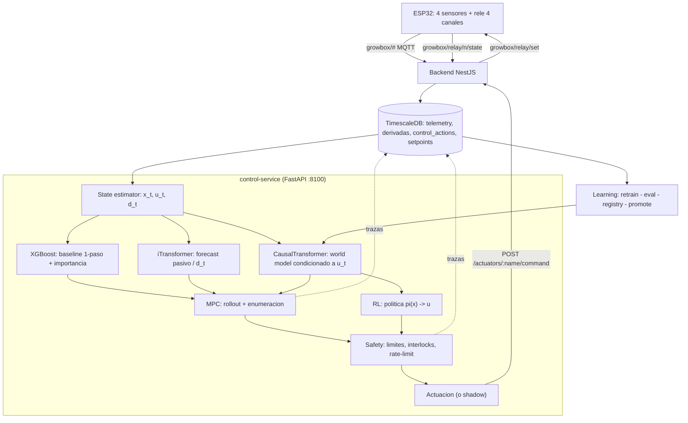
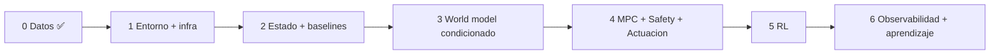

# Especificación de implementación — MPC/RL con los modelos de Astaroth

Documento de trabajo. Concreta **qué se construye, con qué algoritmo y en qué capa**,
para llevar el proyecto de lazo abierto actual a un **control MPC/RL en lazo cerrado**
del ambiente del indoor, usando los modelos ya disponibles en `Astaroth`
(iTransformer, XGBoost, CausalTransformer).

> Complementa a [`arquitectura.md`](./arquitectura.md) (las 9 capas),
> [`control.md`](./control.md) (capas 4–7), [`datos.md`](./datos.md) (contratos de datos)
> y [`roadmap.md`](./roadmap.md) (fases originales). Aquí se **revisa** el plan a la luz
> del objetivo explícito: **predecir el comportamiento del indoor y decidir sobre los
> actuadores**.

---

## 1. Objetivo y alcance

**Objetivo.** Predecir la evolución del ambiente del cultivo `x_{t+1:H}` condicionada a
las acciones de los relés `u_t` y a perturbaciones `d_t`, y con esa predicción **elegir la
secuencia de acciones** que acerque el ambiente a los setpoints `x*` de la fase activa,
con validación previa en una capa de seguridad.

**Alcance explícito (importante).** `x_t` es **estado ambiental** (temperatura, humedad
relativa, CO₂, presión, PAR, NDVI, EC, VPD, dew point) — no fisiología del cultivo
(biomasa, área foliar). El "cultivo" entra por: (a) los **setpoints agronómicos** por fase
(`plant-service`) y (b) el índice vegetal `NDVI` del AS7341. Declararlo así evita
sobreprometer "modelo del cultivo".

---

## 2. Arquitectura objetivo revisada



---

## 3. Rol de cada algoritmo (y el porqué)

Cada modelo de Astaroth ocupa un lugar **distinto y no solapado**. Esto es deliberado.

| Algoritmo | Capa | Entrada | Salida | Rol concreto | Por qué este y no otro |
|---|---|---|---|---|---|
| **XGBoost** (regresión con lags) | 4 (baseline) | `lags(x)`, `lags(u)`, `d` (hora, fase) | `x_{t+1}` por variable | **Baseline one-step** + importancia/SHAP para saber *qué acciones mueven qué variable* | Barato, interpretable, listo en `Astaroth/XGBoost-api`; es el listón que el neuronal debe superar |
| **iTransformer** (`transformerApi`) | 4 (forecast pasivo) | `x_{t-k..t}` (solo estado) | `x_{t+1..t+H}` | **Forecast sin acciones** (¿qué pasaría sin actuar?) y **modelado de `d_t`** | Es seq→seq multivariante, **no condiciona a acciones**: no sirve como world model del MPC, sí como comparación y para contexto |
| **CausalTransformer** (`causalTransformer-api`) | 4 (world model) | `prev_outputs=x`, `prev/current_treatments=u`, `static_features=fase` | `x_{t+1..t+H}` **condicionado a `u`** | **World model del MPC**: rollouts de secuencias de acciones | Es exactamente un *dynamics model* con tratamientos: `x_{t+1}=f(x_t,u_t)` |
| **MPC** (enumeración) | 5 | `x_t`, `x*`, world model | secuencia `u_{t..t+H-1}` | **Decisor primario** | Acciones binarias (2⁴=16) y `H` corto ⇒ enumeración **exacta**; RL no aporta aún |
| **RL** (política) | 5/9 | `x_t`, `x*` | `u_t` (política) | **Acelerador**: destila el MPC en una política rápida y/o resuelve horizontes largos vía MBRL sobre el world model | Justificable cuando `H` crece (objetivos de cultivo a días) o se quiere inferencia a alta frecuencia |
| **Safety** (reglas) | 6 | acción propuesta | aceptada / clamped / rechazada | **Escudo**: valida antes del hardware; escudo también para RL | Es lo único que separa una decisión errónea de un daño físico |

**Reparto en una frase:** XGBoost marca el mínimo a batir y explica; iTransformer da el
"sin acciones" y el contexto; CausalTransformer predice el "si actúo así"; MPC elige
exacto a horizonte corto; RL destila o extiende a horizonte largo; Safety veta; Learning actualiza.

> El **world model se condiciona además a la configuración de los actuadores** (§4.3):
> el mismo canal puede ser luz o riego según cómo esté configurado, y el modelo debe
> saberlo para no mezclar dinámicas.

> Estado de los artefactos en Astaroth (verificado): `XGBoost-api` **utilizable**
> (regresión + metadata en `saved_models/{name}/`); `transformerApi` **con imports
> rotos** (`api.main` vs `apis.main`) y falta el objeto `config`; `causalTransformer-api`
> es el más alineado pero **falta `src/models/`** (no vendorizado) y arrastra
> Celery+Hydra+MLflow+Ray. **Decisión (A6/D9):** se **consumen por HTTP** (`XGBoost-api`
> :8011, `transformerApi` :8013, `causalTransformer-api` :8014) y se **reparan** en la fase
> que los use (D10), no se reimplementan.

---

## 4. Contratos de datos

### 4.1 Vectores

| Vector | Contenido | Fuente | Consumidor |
|---|---|---|---|
| `x_t ∈ R^{10}` | `temperature, humidity, pressure, co2, ec, vpd, dew_point, ndvi, par, ec_compensated` (`datos.md` §1.2) | TimescaleDB `telemetry` | todos |
| `u_t ∈ {0,1}^4` | 4 canales del relé | `control_actions` | XGBoost, CausalFormer, MPC, RL |
| `d_t ∈ R^{m}` | hora del día (sin/cos), día de la semana, fase activa (one-hot), `simulated` | derivado | XGBoost, CausalFormer |
| `x*_τ` | setpoint de la fase activa (**solo parámetros accionables**) | `setpoint_snapshots` | MPC, RL, Safety |

### 4.2 Mapeo del contrato causalTransformer

| Campo causalTransformer | En la tesis | Notas |
|---|---|---|
| `prev_outputs` | `x_{t-k..t}` | estado observado |
| `prev_treatments` | `u_{t-k..t-1}` | historial de acciones |
| `current_treatments` | `u_t` | acción actual |
| `static_features` | fase activa (one-hot), especie | **fijo**, no variable en el tiempo |
| `active_entries` | máscara de validez | huecos por reconexión MQTT |
| **`d_t` variable** | ⚠️ **no tiene hueco propio** | **decisión abierta**: extender el contrato (canal de contexto temporal) o mapearlo a `vitals` |

### 4.3 Registro de actuadores (el relé es genérico)

Los relés **no tienen función fija**: cada canal es libre y se configura para lo que se
conecte (luz, ventilador, extractor, humidificador, riego, calor, inyección de CO₂…).
El contexto **se toma de la configuración del actuador**, no del número de canal, así el
sistema y el modelo son **independientes del dispositivo** conectado.

**Contrato de configuración por canal** (en `actuators.metadata` / `actuator_configs.config`, JSONB):

```json
{
  "channel": 3,
  "label": "riego principal",
  "function": "irrigation",
  "constraints": {
    "max_duration_s": 300,
    "min_interval_s": 3600,
    "max_switches_per_hour": 6,
    "cooldown_s": 120
  },
  "enabled": true
}
```

`function` ∈ `light | ventilation | extraction | humidification | irrigation | heating |
co2_injection | other`.

| Campo | Para qué | Consumidor |
|---|---|---|
| `label` | nombre humano | UI |
| `function` | **pista** de lo conectado (catálogo cerrado); agrupa y da priors | UI, Safety, contexto del world model |
| `constraints` | límites **por canal** (política, no semántica) | Safety |
| `enabled` | inhabilitar un canal | MPC / Safety |

### 4.4 La relación canal→variable es **aprendida**, no declarada

El mismo canal puede afectar varias variables (un extractor mueve `humidity` **y**
`temperature`), y **qué afecta a qué lo descubre el modelo**, no se hardcodea.

- **Matriz de efecto** `E[canal][variable]` (magnitud + signo + confianza) estimada de
datos: por **XGBoost/SHAP** (importancia de cada canal como feature por variable) y/o
por **sensibilidad del CausalFormer** (derivar `x_{t+1}` respecto de cada `u`).
- **El coste del MPC y la decisión de qué es accionable** salen de `E`: una variable es
"accionable" si algún canal tiene efecto significativo sobre ella. Así el sistema **no
depende de un mapeo declarado a mano**.
- `affects`/`direction` en la config son **opcionales y solo pistas** (priors para el
arranque en frío); la fuente de verdad es `E`, versionada.

> ⚠️ **Aprender `E` exige excitación**: si un canal nunca se acciona, no hay datos para
> estimar su efecto. Requiere (a) el simulador con física y/o (b) una política de
exploración suave durante la fase de recolección. **Implementada**: `scripts/excite.js`
> (`npm run excite`) conmuta canales con baja probabilidad respetando las `constraints`
> del registro (`min_interval_s`, `max_duration_s`, `cooldown_s`, `max_switches_per_hour`).

**Estimación (implementada ✅).** `control-service/app/effect.py` + `GET /effect`:
para cada canal y variable calcula `delta = media(ON) − media(OFF)` y su versión
estandarizada (`effect`), con `n_on/n_off` y confianza; y un ranking de canales por
variable. Es la estimación **barata**: no controla todavía por hora/otros canales, así
que coeficientes grandes pueden reflejar correlación temporal (refinable con
transiciones o controlando por `d_t`).

**Consecuencias de diseño**

1. **El world model se condiciona a la configuración** (`function`) como contexto.
   Reconfigurar un canal (p. ej. canal 3 pasa de riego a luz) **cambia la dinámica**:
   sin ese contexto se mezclan datos incompatibles y el modelo se sesga.
2. **La configuración se versiona en el tiempo**: para reconstruir `(x_t, u_t, x_{t+1})`
   hay que saber qué hacía **cada canal en el instante `t`** (tabla
   `actuator_config_snapshots`, ver §8).
3. **Escalable a N canales**: el espacio de acciones es `{0,1}^N` sobre canales
   habilitados, no sobre 4 fijos.

### 4.5 Qué vive en el firmware y qué en la base de datos

El firmware **solo entiende encendido/apagado** por pin; no necesita semántica.

| Dónde | Qué | Por qué |
|---|---|---|
| **Firmware** (`config.cpp`) | pines, `inverted`, intervalos, ON/OFF | capa 1: es el único que toca el hardware |
| **Base de datos** (`actuators`) | `label`, `function`, `constraints`, `enabled` + historial | capa 2/control-service: política y semántica |
| **Artefacto aprendido** | matriz de efecto `E` | capa 4: lo que descubre el modelo |

Por tanto **no** hace falta que el firmware conozca "riego" o "luz": bastan los pines.
La semántica se resuelve aguas arriba (decisión A2: el control vive fuera del ESP).

---

## 5. Especificación por capa

### Capa 3 — State estimator (`control-service/state.py`)

1. **Ventana** `[t-k, t]` (k≈30) por `time_bucket` (decision: **1 min**, ver §7).
2. **Re-muestreo + forward-fill** de acciones; **imputación** de huecos cortos; marca de
   `active_entries` para huecos largos.
3. **Normalización** con `scaler` versionado (media/desv por variable); **outliers** por
   rango físico (reutiliza `unit_bounds` de `plant-service`).
4. **Features temporales** `d_t`: hora sin/cos, día, fase.
5. Salida: tensores `x_hist [k,dim_x]`, `u_hist [k,dim_u]`, `d_hist [k,dim_d]` y `x*`.

**Criterio de aceptación:** dado un instante, `state.py` reconstruye la ventana completa y
el `dataset_hash` reproducible (`scripts/build_dataset.js` ya lo produce).

### Capa 4 — World model (`control-service/world_model.py`)

Interfaz única `predict(x_hist, u_hist, u_future, d) -> x_future[H, dim_x]` con tres
implementaciones intercambiables:

| Impl. | Contrato | Uso |
|---|---|---|
| `Persistence` | `x_{t+1}=x_t` | baseline mínimo |
| `XGB` | one-step con lags | baseline sólido + SHAP |
| `CausalFormer` | contrato §4.2 | rollout condicionado (MPC) |
| `iTransformer` | sx solo `x` | forecast pasivo / contexto (no MPC) |

**Artefacto** versionado: pesos + scaler + `metadata.json` (`version`, `dataset_hash`,
MAE/RMSE por variable y horizonte, fecha, `data_source: simulated|real`).
**Criterio:** el baseline **supera a persistencia** en las variables objetivo; el
CausalFormer iguala o mejora al baseline.

**Matriz de efecto `E[canal][variable]`** (ver §4.4): se estima aquí, a partir del baseline
Shapley/`SHAP` del XGBoost y de la sensibilidad del CausalFormer (`∂x_{t+1}/∂u`). Es el
artefacto que informa al MPC **qué canal mueve qué variable** y con qué signo, sin mapeo
declarado. Se versiona junto al modelo.

### Capa 5 — MPC (`control-service/mpc.py`)

```
min_{u_t..u_{t+H-1}}  Σ_τ [ w_x·‖x_τ − x*_τ‖² + w_Δu·‖u_τ − u_{τ-1}‖ ]
s.a.  x_τ+1 = world_model(x_τ, u_τ, d_τ);  u_τ ∈ {0,1}^N;  restricciones de Safety
```

- **Método:** enumeración exacta `2^(N·H)` (`N` = canales habilitados) — viable con
  `H=3–6` y `N=4`. `H` grande ⇒ MPPI/CEM.
- **Qué es accionable:** se deriva de la **matriz de efecto `E`** (§4.4): una variable
  entra en el coste si algún canal tiene efecto significativo sobre ella. El MPC
  **usa la relación aprendida**, no un mapeo declarado.
- **Coste** solo sobre parámetros **accionables** de `x*` (los informativos —co2, ec, ph—
  no entran como objetivo de control; ver `datos.md` §3).
- **Frecuencia de decisión:** 1–5 min.
- **RL (alternativa/complemento):** política `π(x_t, x*)→u_t` entrenada (a) en el
  entorno simulado con física, o (b) por *model-based RL* sobre el CausalFormer. Se usa
  cuando `H` es largo o se requiere inferencia rápida; se valida **contra** el MPC.

### Capa 6 — Safety (`control-service/safety.py`)

| Regla | Parámetro |
|---|---|
| Límites físicos | canal ∈ 1..4, estado ∈ {ON,OFF}; rangos de sensores |
| `min_interval` de riego | `irrigation.min_interval_hours` (ya declarado en `plant-service`) |
| Interlocks | p.ej. no riego si humedad de sustrato alta; no ventilación+humidificación |
| Rate limit | máx. conmutaciones/canal/ventana |
| Duración máxima | corte tras `duration_seconds` |
| Watchdog | si `control-service` cae ⇒ estado seguro por canal |
| Kill-switch | deshabilita MPC/RL |

Contrato de decisión: `{time, channel, proposed_state, decision, applied_state, rule, reason}`.
**Todas las constraints** (`min_interval`, `max_duration`, `rate limit`, `cooldown`) salen
del **registro de actuadores** (§4.3), por canal configurado — **no hardcodeadas**. Así,
si mañana un canal cambia de función, sus límites vienen de su configuración.
**Responsable único de la validación final** (hoy el backend valida canal/estado; hay que
unificar para no divergir).

### Capa 7 — Actuación (`control-service/actuation.py`)

- **Shadow mode (primero):** decide y **registra**, no publica.
- **Real:** `POST /actuators/:name/command` → backend → `growbox/relay/set` → ESP confirma.
- **Acks/idempotencia:** id de comando para no reaplicar; registrar confirmación.

### Capa 8 — Observabilidad

- Tablas nuevas: `predictions (time, model_version, horizon, variable, y_pred, y_real, error)`
  y `control_decisions (time, source, x_state, action, cost, decision, rule, model_version)`.
- `/metrics` (Prometheus): latencia de ingesta, mensajes MQTT, error de predicción,
  decisiones/min, rechazos/min.
- Alarmas y dashboard (estado, setpoints, acciones, salud del modelo).

### Capa 9 — Learning / model update

```
build_dataset → train → evaluate (vs persistencia y vs versión activa)
              → registry → shadow → canary → promote
```

| Componente | Función |
|---|---|
| `build_dataset` | ✅ implementado (`scripts/build_dataset.js`) |
| `train` | entrena candidato (XGB / CausalFormer) |
| `evaluate` | MAE/RMSE por horizonte vs persistencia y vs activo |
| `registry` | artefactos versionados (`version`, `dataset_hash`, métricas) |
| `promote` | cambia versión activa (manual o por criterio), auditado |

---

## 6. Fases revisadas

El plan original se **revisa** por un hallazgo bloqueante: el simulador actual no acopla
acciones ↔ sensores, así que hoy **no hay dinámica que aprender**. Se introduce una fase
de entorno antes de toda la parte de modelos.

| Fase | Capas | Objetivo | Entregables | Criterio de aceptación |
|---|---|---|---|---|
| **0 ✅** | 2 | Datos y contratos | `control_actions`, `x_t` v1, `build_dataset`, marca `simulated`, setpoints históricos | Reconstruir `(x_t,u_t,x_{t+1})`; tensores con split temporal |
| **1 — Entorno con dinámica** | 1–2 | Que el sistema tenga **dinámica que aprender** y esté configurable | Simulador con física (relé→sensores); registro de actuadores (función/constraints) + snapshot; contrato `d_t`; esqueleto `control-service` en `dev.js` | Al accionar un canal en sim, la variable acoplada cambia de forma monótona y reproducible, y la matriz `E` la recupera |
| **2 — State estimator + baselines** | 3, 4(barata) | `x_t` usable y predicción mínima medida | `state.py`; **montar + reparar Astaroth**; baselines persistencia + XGBoost + iTransformer (vía HTTP); `/predict`; métricas | Baseline supera a persistencia; `dataset_hash` versionado |
| **3 — World model condicionado** | 4 | Predicción condicionada a acciones | Integración CausalFormer (contrato §4.2); rollout multi-paso; comparación vs Fase 2 | Rollout `H` pasos con MAE/RMSE por horizonte ≤ baseline |
| **4 — MPC + Safety + Actuación** | 5,6,7 | Cerrar el lazo, primero en shadow | `mpc.py`, `safety.py`, `actuation.py`, tablas `control_decisions` | Shadow: propone y registra; Safety rechaza casos de prueba; real: el ESP confirma |
| **5 — RL** | 5,9 | Política rápida / horizonte largo | Entorno RL (sim con física); política π; MBRL sobre el world model | La política iguala al MPC en sim y/o lo supera a horizonte largo, con Safety activo |
| **6 — Observabilidad + aprendizaje** | 8,9 | Operación y mejora continua | `/metrics`, alarmas, dashboard; pipeline `train→eval→registry→promote` | Error en vivo visible; reentrenamiento sin pasos manuales; promociones auditadas |



**Estado Fase 1 (✅).** Hecho: física en `tools/esp-sim.js` (los relés modifican las
variables del ambiente), registro de actuadores + snapshots (`plant-service`:
`actuator_registry`, `actuator_config_snapshots`), esqueleto de `control-service`
(`:8100`) integrado en `dev.js`, contrato `d_t` (hora/día → *vitals*; fase →
`static_features`) y `scripts/excite.js` (excitación suave guiada por `constraints`).
Desbloquea la Fase 2.

**Estado Fase 2 (✅).** Hecho: `control-service` con `state.py` (`GET /state`),
baselines persistencia / XGBoost / iTransformer consumidos de **Astaroth por HTTP**,
`POST /predict` (H configurable), `POST /evaluate` (MAE/RMSE vs persistencia),
registry (`control_service.model_registry`) y **matriz de efecto `E`** (`GET /effect`).
**Astaroth montado y reparado**: `transformerApi` (imports `api.main`→`apis.config`, +
`config`) y `XGBoost-api` (`DataService.records_to_dataframe`). Desbloquea la Fase 3.

---

## 7. Decisiones abiertas (a cerrar antes de Fase 2)

| # | Decisión | Propuesta por defecto |
|---|---|---|
| D1 | Cadencia de decisión y re-muestreo | 1 min (sensores 15–25 s) |
| D2 | Horizonte `H` | 3–6 pasos |
| D3 | Cómo entra `d_t` en el contrato causal | ✅ resuelto: hora/día → *vitals*; fase → `static_features` |
| D4 | Registro de actuadores: `function`/`constraints` + versionado | JSONB en `actuators`/`actuator_configs` + snapshot histórico |
| D5 | Física del simulador | ver Fase 1 |
| D6 | Rol de RL | destilación del MPC + MBRL; no RL libre primero |
| D7 | Fuente única de telemetría | consolidar en `telemetry` (backend) |
| D8 | Relación canal→variable | **aprendida** (matriz `E`), no declarada |
| D9 | Modelos de predicción | **se consumen de Astaroth por HTTP** (:8011/:8013/:8014), no se reimplementan |
| D10 | Reparación de Astaroth | en la fase que los use: `transformerApi` (imports + `config`) en Fase 2; `causalTransformer` (`src/models/`) en Fase 3 |
| D11 | Cadencia / ventana / horizonte | `freq=1 min`, `k=15`, `H=6` |
| D12 | Normalización | z-score por variable (robusto si hay outliers), ajustado en train y **compartido con el coste del MPC** |

---

## 8. Mapa de lo que falta implementar

| Componente | Estado | Fase |
|---|---|---|
| `control_actions`, `x_t`, `build_dataset`, `simulated`, setpoints históricos | ✅ | 0 |
| Física en `tools/esp-sim.js` (acción→sensor) | ✅ | 1 |
| Registro de actuadores (config por canal: función/constraints) | ✅ | 1 |
| `actuator_config_snapshots` (config vigente en el tiempo `t`) | ✅ | 1 |
| Política de excitación suave (para poder aprender `E`) | ✅ | 1 |
| Contrato `d_t` | ✅ | 1 |
| `control-service/` (esqueleto, `dev.js`, `/health`) | ✅ | 1 |
| `state.py` (ventana, imputación, normalización) | ✅ | 2 |
| Baseline persistencia + XGBoost + iTransformer | ✅ | 2 |
| `/predict`, métricas MAE/RMSE vs persistencia | ✅ | 2 |
| **Matriz de efecto `E[canal][variable]`** (aprendida, SHAP/sensibilidad) | ✅ | 2 |
| Registry de modelos (versión, `dataset_hash`) | ✅ | 2 |
| World model CausalFormer integrado | ❌ | 3 |
| Rollout multi-paso condicionado | ❌ | 3 |
| `mpc.py` (enumeración) | ❌ | 4 |
| `safety.py` (reglas de §5, capa 6) | ❌ | 4 |
| `actuation.py` (shadow + acks) | ❌ | 4 |
| Tablas `control_decisions`, `predictions` | ❌ | 4 |
| Entorno RL + política + integración | ❌ | 5 |
| `/metrics`, alarmas, dashboard | ❌ | 6 |
| Pipeline `train→eval→registry→promote` | ❌ | 6 |
| Sensores/actuadores **reales** cableados | ❌ | transversal |

---

## 9. Riesgos

| Riesgo | Impacto | Mitigación |
|---|---|---|
| Simulador sin acoplamiento acción→sensor | **Bloquea la validez** | Fase 1: dar física mínima |
| Piezas faltantes en Astaroth | Retrasa Fase 3 | Adoptar contrato, implementar baseline propio primero |
| Cierre del lazo = datos no estacionarios | Modelo se desajusta | Shadow mode, splits temporales, reentrenamiento |
| Escalas temporales (ambiente min vs cultivo días) | Objetivos de cultivo fuera del horizonte | Declarar alcance; RL para horizontes largos |
| Doble responsabilidad de Safety | Divergencia | Responsable único de validación final |
| Sin hardware real | Datos no representativos | Marcar `simulated`; cablear sensores |
