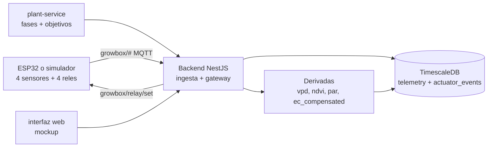
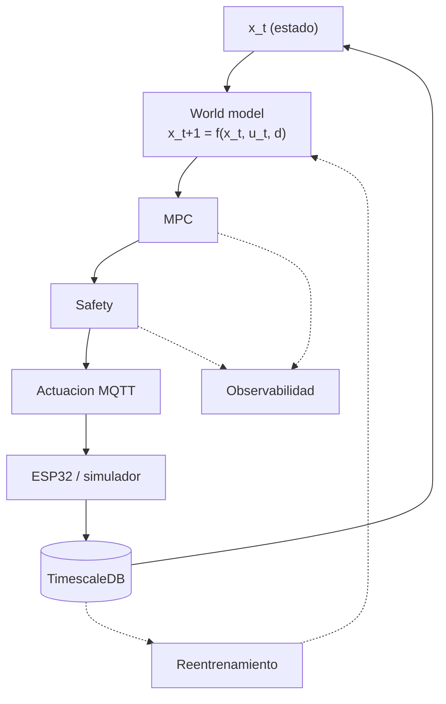
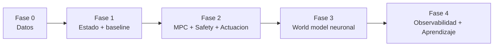

# Plan de migración: de la arquitectura actual a la objetivo

Este documento responde a tres preguntas: **¿qué hay hoy?**, **¿a qué queremos
llegar?** y **¿cómo migramos?** Es la vista de transición; el detalle de cada
criterio de aceptación está en [`roadmap.md`](./roadmap.md), y el diseño de cada
capa en [`arquitectura.md`](./arquitectura.md), [`datos.md`](./datos.md),
[`control.md`](./control.md) y [`observabilidad-aprendizaje.md`](./observabilidad-aprendizaje.md).

> **Principio rector:** cerrar el lazo con un **baseline barato** antes de invertir
> en modelos neuronales.

## 1. Arquitectura actual (as-is)

Pipeline **abierto** de adquisición → almacenamiento → configuración por fases.
**No hay lazo cerrado**: nadie decide acciones automáticamente a partir del estado.

**Lo que ya funciona**

- Hardware real y **simulador** (`tools/esp-sim.js`) si no hay placa.
- Broker MQTT en contenedor, ingesta a TimescaleDB e **hypertable** `telemetry`.
- Métricas **derivadas** (`backend/src/derivates`).
- **Comandos de relé** de ida y vuelta (backend → MQTT → ESP → confirmación).
- **Configuración por fases** con objetivos (plant-service, esquema `plant_service`).
- `dev.js`: orquestación, validación de interconexiones, kill de puertos y arranque sin duplicados.

**Lo que no existe**

- Vector de estado `x_t` explícito.
- Modelo de dinámica (world model).
- MPC y capa de seguridad real.
- Trazas de decisión del modelo y reentrenamiento.

## 2. Arquitectura objetivo (to-be)

Lazo cerrado: el estado se estima, se predice, se decide y la acción pasa por
la capa de **safety** antes de llegar al relé. Todo queda trazado para aprender.

## 3. Brecha por capa

| # | Capa | Hoy | Falta |
|---|---|---|---|
| 1 | Hardware / adquisición | ✅ real **+ simulador** | Sensores reales conectados |
| 2 | Data platform | 🟡 telemetría ok; acciones en `actuator_events` | `control_actions` (serie de `u_t`), setpoints históricos, fuente única |
| 3 | State estimator | 🟡 derivadas deterministas | vector `x_t` + normalización + ventanas |
| 4 | World / dynamics model | ❌ | modelo de dinámica (baseline → Astaroth) |
| 5 | MPC | ❌ | optimizador de horizonte corto |
| 6 | Safety layer | 🟡 validación básica | límites, interlocks, rate-limit, kill-switch |
| 7 | Actuation / control interface | 🟡 camino existe, sin controlador | MPC como actor + acks + shadow mode |
| 8 | Monitoring / observability | 🟡 logs y health | `control_decisions`, `predictions`, alarmas |
| 9 | Learning / model update | ❌ | `build_dataset → train → eval → registry → promote` |

## 4. Plan por fases

### Fase 0 — Datos y contratos (desbloquea todo, sin ML)

| Entregable | Dónde |
|---|---|
| Tabla `control_actions` (`u_t`, incluye manuales y rechazadas) | `db/init.sql` (esquema en `datos.md` §2.2) |
| Registro de acciones desde el backend | `backend/src/actuators`, `backend/src/mqtt` |
| Contrato de estado `x_t` | `datos.md` §1.2 |
| Script `build_dataset` (ventanas `x_hist, u_hist, d, y_futuro`) | `scripts/` |
| Decisión de **fuente única** de telemetría | backend vs `plant_service` |

**Aceptación:** se reconstruye `(x_t, u_t, x_{t+1})` para un rango; `build_dataset` produce tensores `[N, k, dim]` con split temporal; cada muestra marca simulado/real.

**Estado:** ✅ implementado — tabla `control_actions` (`db/init.sql`), registro desde el backend, marca `simulated` (firmware + simulador + backend + dataset), contrato `x_t` v1, setpoints históricos (`plant_service.setpoint_snapshots`) y `scripts/build_dataset.js`.

### Fase 1 — State estimator + baseline de dinámica

| Entregable | Dónde |
|---|---|
| Servicio `control-service` (FastAPI, :8100) | `control-service/`, integrado en `dev.js` |
| Construcción de `x_t` (normalización, imputación) | `control-service/state.py` |
| Baseline de dinámica (lineal o XGBoost) | `control-service/world_model.py` |
| Endpoint `/predict` (H configurable) | `control-service/api/` |

**Aceptación:** `/predict` devuelve `x_{t+1..t+H}`; el baseline **supera** al de persistencia; versión y `dataset_hash` registrados.

### Fase 2 — MPC + safety + actuación

| Entregable | Dónde |
|---|---|
| MPC (acciones binarias, horizonte corto, enumeración) | `control-service/mpc.py` |
| Safety (límites, `min_interval` riego, interlocks, rate-limit, kill-switch) | `control-service/safety.py` |
| Actuación (o **shadow mode**) | `control-service/actuation.py` → `growbox/relay/set` |
| Trazas de decisión | tabla `control_decisions` |

**Aceptación:** en shadow mode el MPC propone y se registra; safety rechaza casos de prueba; con actuación real un relé cambia y el ESP confirma.

### Fase 3 — World model neuronal

| Entregable | Dónde |
|---|---|
| Modelo neuronal (iTransformer / Causal Transformer) | reuso de **Astaroth**, ver `control.md` §1.2 |
| Adaptación temporal (cadencia 15–25 s → re-muestreo) | `control-service/` |
| Comparación vs baseline (shadow) | registry de modelos |

**Aceptación:** iguala/mejora al baseline con datos reales; reentrenable de forma reproducible.

### Fase 4 — Observabilidad y aprendizaje

| Entregable | Dónde |
|---|---|
| Métricas, alarmas y watchdog | `/metrics`, ver `observabilidad-aprendizaje.md` §8 |
| Dashboard (estado, setpoints, acciones, salud del modelo) | `interfaz web/` |
| Pipeline `train → eval → registry → promote` | `scripts/` + Astaroth |

**Aceptación:** error de predicción visible en vivo; reentrenamiento sin pasos manuales; promociones auditadas.

## 5. Qué se reutiliza

| Pieza existente | Uso en el objetivo |
|---|---|
| Camino de actuación (backend → MQTT → ESP) | Salida de la capa 7 (`control.md` §4) |
| **Simulador** `tools/esp-sim.js` | Desarrollar el MPC sin hardware; generar datos sintéticos |
| Setpoints por fase (`plant-service`) | Referencia `x*` del coste del MPC (`datos.md` §3) |
| Métricas derivadas (`backend/src/derivates`) | Base del vector `x_t` |
| **Astaroth** (`transformerApi`, `causalTransformer-api`) | Arquitectura del world model (capa 4) |
| `dev.js` (orquestación, simulación, kill de puertos) | Despliegue del `control-service` |

## 6. Decisiones abiertas

| # | Decisión | Propuesta por defecto |
|---|---|---|
| D1 | Cómo llegan los setpoints al ESP | Vía backend/MQTT (no HTTP en el ESP) |
| D2 | Fuente única de telemetría | Consolidar en `telemetry` (backend) |
| D3 | Ubicación del control | Servicio `control-service` (:8100) |
| D4 | Modelo final de la capa 4 | Baseline primero; transformer después |
| D5 | MPC: horizonte y frecuencia | `H = 3–6`, decisión cada 1–5 min |
| D6 | Cadencia común de re-muestreo | 1 min |
| D7 | Definición exacta de `x_t` | Subconjunto de `datos.md` §1.2 |
| D8 | MPC o RL | MPC (RL solo si se justifica) |

## 7. Próximo paso

Empezar por la **Fase 0** (barata y desbloqueante):

1. Tabla `control_actions` en `db/init.sql` y su registro desde el backend.
2. Contrato de `x_t` cerrado en `datos.md`.
3. Script `build_dataset`.

Alternativa: cerrar primero las decisiones D1–D8 con los valores por defecto
propuestos.
