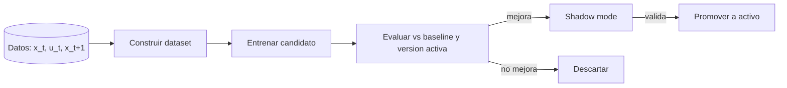

# Observabilidad y aprendizaje (capas 8–9)

## Capa 8 — Monitoring / observability 🟡

Todo el sistema debe ser **auditable**: qué se midió, qué se predijo, qué se decidió
y qué se ejecutó. Sin esto no se puede depurar el control ni demostrar su validez.

### 8.1 Lo que ya existe

| Elemento | Ruta |
|---|---|
| Logs de servicios | `logs/*.log` (generados por `dev.js`) |
| Healthchecks de contenedores | `db/docker-compose.yml` (`cea-timescaledb`, `cea-mqtt`) |
| Salud del backend | `backend/src/health/health.controller.ts` (`/health`, `/health/mqtt`, `/health/telemetry-count`) |
| Salud de plant-service | `plant-service/app/api/routes/health.py` |
| Histórico de actuadores | tabla `actuator_events` |
| Arranques de dispositivo | tabla `device_boots` |

### 8.2 Lo que falta

| Aspecto | Propuesta |
|---|---|
| **Métricas** | Endpoint `/metrics` (Prometheus): latencia de ingesta, mensajes MQTT, error de predicción, decisiones/min |
| **Trazas de decisión** | Tabla `control_decisions` (`datos.md`) con coste, restricciones y resultado |
| **Predicciones** | Tabla `predictions` (`time, horizon, variable, y_pred, y_real`) para medir error en vivo |
| **Alarmas** | Umbrales por variable (`co2`, `temperature`, `vpd`), desconexión de dispositivo, watchdog del control |
| **Dashboard** | Vista en `interfaz web/` con estado actual, setpoints, acciones y salud del modelo |
| **Estado del modelo** | Versión activa, fecha de entrenamiento, `dataset_hash`, drift |

### 8.3 Esquema de trazas (propuesto)

```sql
-- PROPUESTO
CREATE TABLE control_decisions (
    time          TIMESTAMPTZ NOT NULL,
    source        TEXT NOT NULL,          -- mpc | safety | manual
    x_state       JSONB NOT NULL,         -- estado observado
    action        JSONB NOT NULL,         -- accion propuesta {canal: ON/OFF}
    cost          DOUBLE PRECISION,       -- coste estimado por el MPC
    decision      TEXT NOT NULL,          -- accepted | clamped | rejected
    rule          TEXT,                   -- regla de safety que intervino
    model_version TEXT,
    created_at    TIMESTAMPTZ NOT NULL DEFAULT now()
);

CREATE TABLE predictions (
    time          TIMESTAMPTZ NOT NULL,
    model_version TEXT NOT NULL,
    horizon       SMALLINT NOT NULL,
    variable      TEXT NOT NULL,
    y_pred        DOUBLE PRECISION NOT NULL,
    y_real        DOUBLE PRECISION,       -- se rellena al llegar la medicion
    error         DOUBLE PRECISION
);
```

### 8.4 Alarmas mínimas

| Alarma | Condición |
|---|---|
| Dispositivo offline | LWT `offline` o sin `data` > N× intervalo |
| CO₂ fuera de rango | `co2` fuera de `[min, max]` de la fase |
| Estrés hídrico | `vpd` o `ec_compensated` fuera de rango |
| Watchdog de control | `control-service` no decide en > N minutos |
| Deriva del modelo | error de predicción por encima de umbral sostenido |

## Capa 9 — Learning / model update ❌

Ciclo de mejora continua: los datos nuevos alimentan el reentrenamiento y las
mejores versiones sustituyen a las activas, siempre con validación.



### 9.1 Componentes propuestos

| Componente | Función |
|---|---|
| `build_dataset` | Ventanas `(x_hist, u_hist, d_hist, y_future)` desde TimescaleDB (`datos.md` §4) |
| `train` | Entrena candidato (baseline o transformer) |
| `evaluate` | MAE/RMSE por horizonte vs. baseline de persistencia y vs. versión activa |
| `registry` | Versionado de artefactos (`version`, `dataset_hash`, métricas, fecha) |
| `promote` | Cambia la versión activa (manual o por criterio) |

Se reutilizan ideas/scripts de **Astaroth** (`Astaroth/transformerApi/apis/train.py`,
`Astaroth/causalTransformer-api/runnables/train_*.py`), adaptados a las variables
del cultivo.

### 9.2 Política de actualización

1. **Nunca** cambiar el modelo activo sin comparación contra el vigente.
2. Nuevo modelo entra primero en **shadow mode** (predice, no actúa).
3. Promoción gradual (canary) si hay control real.
4. Toda promoción queda registrada (versión, fecha, métricas, responsable).

### 9.3 Datos necesarios (bloqueante)

El reentrenamiento serio requiere:
- `u_t` registrado (Fase 0 del `roadmap`).
- Sensores **reales** (hoy simulación, ver `datos.md` §7).
- Setpoints versionados en el tiempo.
