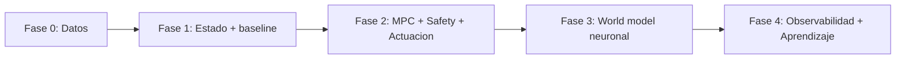

# Roadmap

Plan por fases para pasar del estado actual (lazo abierto, sin cerebro) a un
sistema con **MPC/RL en lazo cerrado**. Cada fase tiene entregables y criterios de
aceptación verificables.

> **Principio rector:** cerrar el lazo con un baseline barato antes de invertir en
> modelos neuronales. Ver `README.md`.

## Fase 0 — Datos y contratos (prerrequisito, sin ML)

**Objetivo:** que exista el material para aprender dinámica.

| Entregable | Detalle |
|---|---|
| Tabla `control_actions` | Registra toda acción (`u_t`), incluida manual y rechazada (`datos.md` §2.2) |
| Contrato de estado `x_t` | Vector, unidades, normalización, ventana (`datos.md` §1.2) |
| `build_dataset` | Script que genera ventanas `(x_hist, u_hist, d_hist, y_future)` |
| Fuente única de telemetría | Decidir backend vs plant-service (`arquitectura.md` A3) |
| Marca simulado/real | Flag en los datos |

**Criterios de aceptación**
- Se puede reconstruir la secuencia `(x_t, u_t, x_{t+1})` para un rango de tiempo.
- `build_dataset` produce tensores con forma `[N, k, dim]` y split temporal.
- Cada muestra indica si proviene de datos simulados.

**Depende de:** nada. **Desbloquea:** Fase 1.

## Fase 1 — State estimator + baseline de dinámica (capas 3–4 baratas)

**Objetivo:** predecir el estado siguiente y medir el error.

| Entregable | Detalle |
|---|---|
| `control-service` (esqueleto) | FastAPI, integrado en `dev.js` (`control.md` §4.1) |
| Construcción de `x_t` | Desde TimescaleDB con normalización e imputación |
| Baseline de dinámica | Lineal de espacio de estados o XGBoost (`control.md` §1.1) |
| Predicción 1–3 pasos | Endpoint `/predict` |
| Evaluación | MAE/RMSE por variable y horizonte vs. persistence baseline |

**Criterios de aceptación**
- `/predict` devuelve `x_{t+1..t+H}` con `H` configurable.
- El baseline **supera** al persistence baseline en al menos las variables objetivo.
- Las métricas y el `dataset_hash` quedan versionados.

**Depende de:** Fase 0. **Desbloquea:** Fase 2.

## Fase 2 — MPC + safety + actuación (capas 5–7)

**Objetivo:** cerrar el lazo, primero en shadow mode.

| Entregable | Detalle |
|---|---|
| MPC | Horizonte corto, acciones binarias, enumeración exacta (`control.md` §2) |
| Safety layer | Límites, `min_interval` de riego, interlocks, rate limit, kill-switch (`control.md` §3) |
| Actuación | Publicar por el camino existente (`growbox/relay/set`) o shadow |
| Trazas de decisión | Tabla `control_decisions` (`observabilidad-aprendizaje.md` §8.3) |

**Criterios de aceptación**
- En **shadow mode**, el MPC propone acciones periódicamente y estas se registran.
- El safety layer rechaza correctamente casos de prueba (riego demasiado seguido,
  canal inválido, rate limit).
- Al activar actuación real, un comando del MPC cambia un relé y el ESP confirma
  (`actuator_events` con `reason` del MPC).

**Riesgo:** actuación sobre hardware real. Mitigar con shadow mode y límites.

**Depende de:** Fase 1. **Desbloquea:** Fase 3.

## Fase 3 — World model neuronal (capa 4 avanzada)

**Objetivo:** sustituir el baseline por un modelo que capture dinámica no lineal.

| Entregable | Detalle |
|---|---|
| Modelo neuronal | iTransformer o Causal Transformer (`control.md` §1.2) |
| Reutilización de Astaroth | Vendorizar/reparar piezas faltantes (`src/models/`, `config`) |
| Adaptación temporal | Re-muestreo y `seq_len` según cadencia real (15–25 s) |
| Comparación | vs. baseline de Fase 1, en shadow mode |

**Criterios de aceptación**
- El modelo neuronal **iguala o mejora** al baseline en las variables objetivo, con
  datos reales.
- Se puede reentrenar de forma reproducible desde `build_dataset`.
- Integrado como versión alternativa en el registry.

**Depende de:** Fase 2 + datos reales. **Desbloquea:** Fase 4.

## Fase 4 — Observabilidad y aprendizaje (capas 8–9)

**Objetivo:** operación sostenible y mejora continua.

| Entregable | Detalle |
|---|---|
| Métricas y alarmas | `/metrics`, umbrales, watchdog (`observabilidad-aprendizaje.md` §8) |
| Dashboard | Estado, setpoints, acciones, salud del modelo |
| Pipeline de reentrenamiento | `build_dataset → train → evaluate → registry → promote` |
| Política de promoción | Shadow → canary → activo, con registro |

**Criterios de aceptación**
- El error de predicción en vivo es visible y se alerta si deriva.
- Un reentrenamiento completo se ejecuta sin pasos manuales.
- Toda promoción de modelo queda auditada.

**Depende de:** Fase 3.

## Resumen

| Fase | Capas | Estado dep. | Riesgo principal |
|---|---|---|---|
| 0 | 2 | — | Falta registrar acciones |
| 1 | 3, 4 (baseline) | Fase 0 | Datos simulados |
| 2 | 5, 6, 7 | Fase 1 | Actuación sobre hardware |
| 3 | 4 (neuronal) | Fase 2 + datos reales | Piezas faltantes en Astaroth |
| 4 | 8, 9 | Fase 3 | Drift / operación |

## Bloqueantes transversales

1. **Sensores reales.** Hoy en simulación (`datos.md` §7).
2. **Reconexiones MQTT del ESP.** Generan huecos; corregir keepalive en firmware.
3. **Setpoints históricos.** `plant-service` guarda el valor actual, no la serie.
